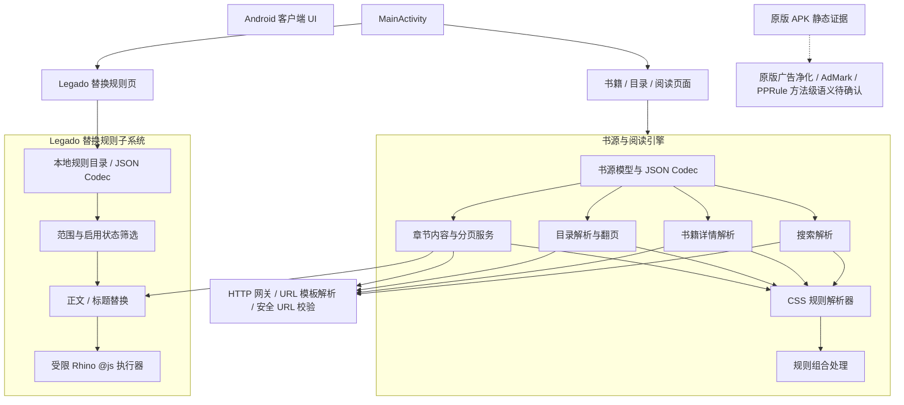

# 当前客户端结构图（实现状态）

> 本图按仓库当前实现整理。虚线表示尚未完成的原版能力追踪，不代表已迁移。

## 已实现的主要路径

- Android 页面可进入书源阅读流程与 Legado 替换规则验证页面。
- 书源 JSON 编解码、受限 CSS 搜索/目录/章节解析及 HTTP 请求路径已建立。
- 替换规则包含本地 JSON 导入导出、范围筛选、字面量替换与受限 Rhino 执行入口。
- 搜索结果、书籍详情请求地址、封面/目录链接、目录章节链接和目录翻页链接统一限制为非空、无凭据的 HTTP(S) URL；相对链接按响应 URL 解析。
- Legado `ElementsSingle` 的索引/排除语法（如 `.index`、`!exclude`、`[index/range]`）属于独立的规则解析阶段；当前 CSS 子集不会将这些写法误当作 CSS 选择器扩展，也尚未实现该阶段。上游 `@CSS:` 规则与非 CSS 规则的索引处理路径不同，后续必须先按原始规则类型分流，再实现负索引、区间步长、排除与反转语义，不能简单截取 CSS 选择器尾部字符。
- CSS 规则取值支持 `@CSS:` 前缀、`@textNodes`（仅直接文本节点，去除空白节点并以实际换行连接）、`@all`（按 Legado 行为返回匹配元素集合合并后的 outerHTML）、`@html`（移除 script/style 后返回匹配元素集合合并后的 outerHTML），并支持 Legado 风格的直接属性后缀（如 `@data-id`，跳过空值并去重）。搜索 `bookList` 与目录 `chapterList` 另走元素集合提取入口，逐项保留 HTML 节点边界，避免把多本书或多个章节合并为单个项目；仍属于受限 CSS 子集，不代表完整 Legado AnalyzeRule 兼容。
- 书源 HTTP 重定向逐跳校验：拒绝带凭据的目标、显式非 HTTP(S) 协议与 HTTPS 降级到 HTTP，允许安全的跨域 HTTPS 跳转。
- 目录与章节分页均设置页数上限；章节分页遇到请求 URL 或 HTTP 重定向后的最终 URL 循环、或页数超限时返回明确错误，不把部分正文伪装成完整成功结果。
- 目录与章节分页的安全页数计数独立于 URL 循环别名集合：HTTP 重定向前后的 URL 都用于循环识别，但每次成功响应只计为一页，避免重定向被误算成额外分页。
- 目录与章节分页循环检测会忽略 URL 的 `#fragment`：片段不参与 HTTP 资源请求，不能让同一资源通过变换片段逃过循环检测；目录待处理队列也按去片段后的身份去重。
- 章节正文的下一页选择器遇到 CSS 语法错误时会返回 `UNSUPPORTED_RULE`，不让第三方书源的坏选择器直接抛出解析异常。
- 目录下一页选择器遇到 CSS 语法错误时同样返回 `UNSUPPORTED_RULE`，避免错误书源配置造成未处理异常。
- 新增书籍详情 → 目录 → 章节正文的集成测试，验证服务之间传递的 URL 与书籍信息。

## 当前明确未完成

- 完整 Legado AnalyzeRule 语法、XPath/JSONPath 全覆盖、完整书源 JS/网络请求运行时。
- 原版坏坏猫净化逻辑的真实方法级迁移（WebView 注入、AdMark 服务、PPRule 执行语义尚未验证）。
- 原版 APK 的 UI 逐页还原、真机全流程验收与最终发布 APK。
